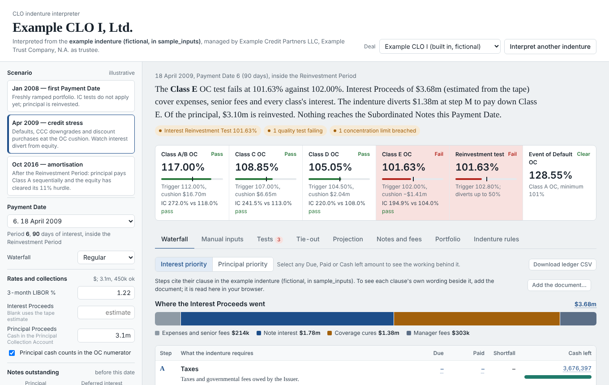
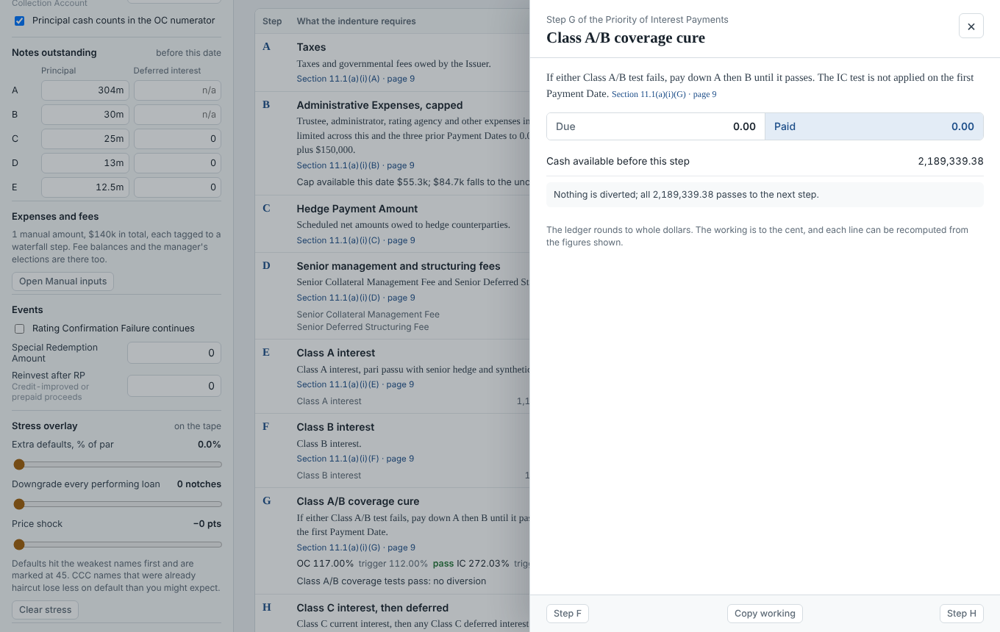
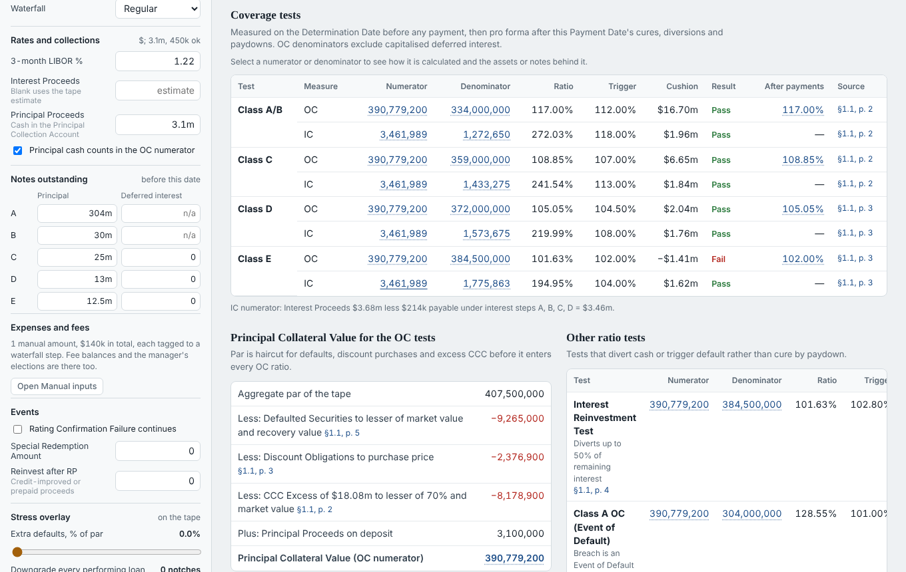
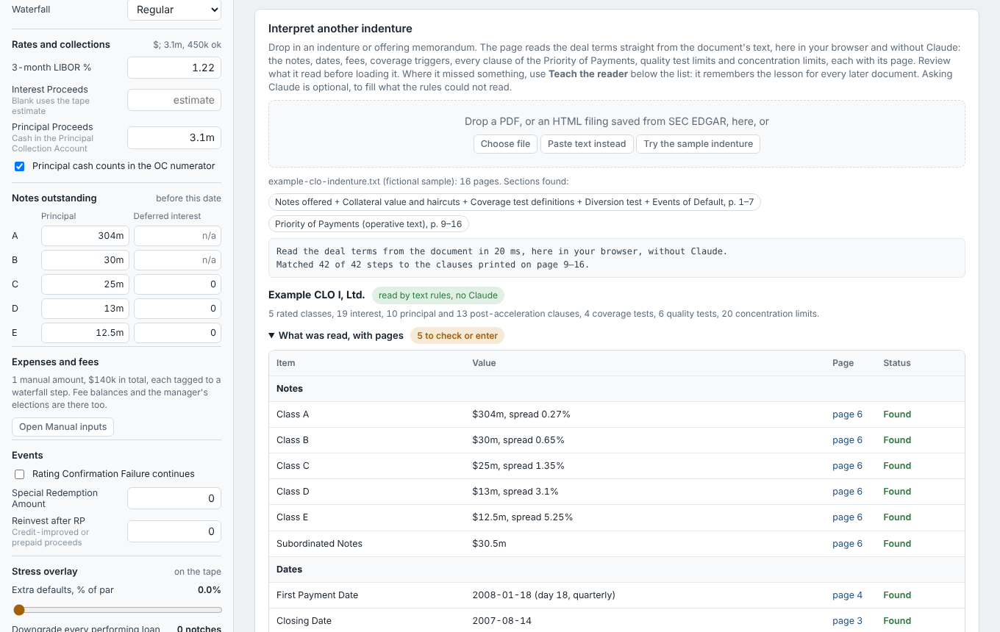
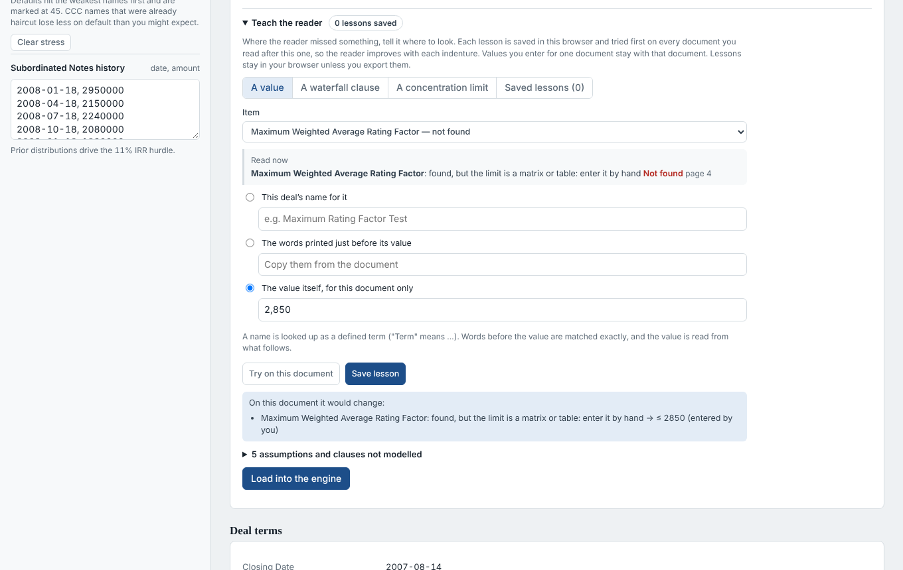
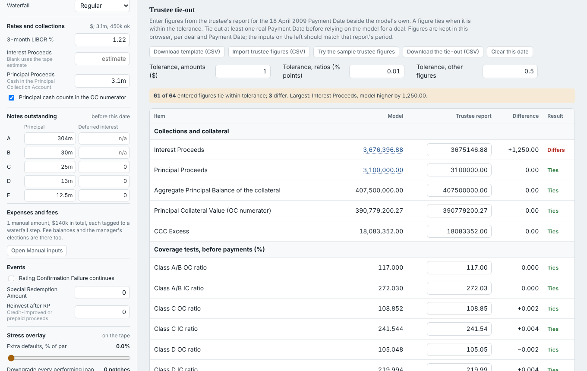
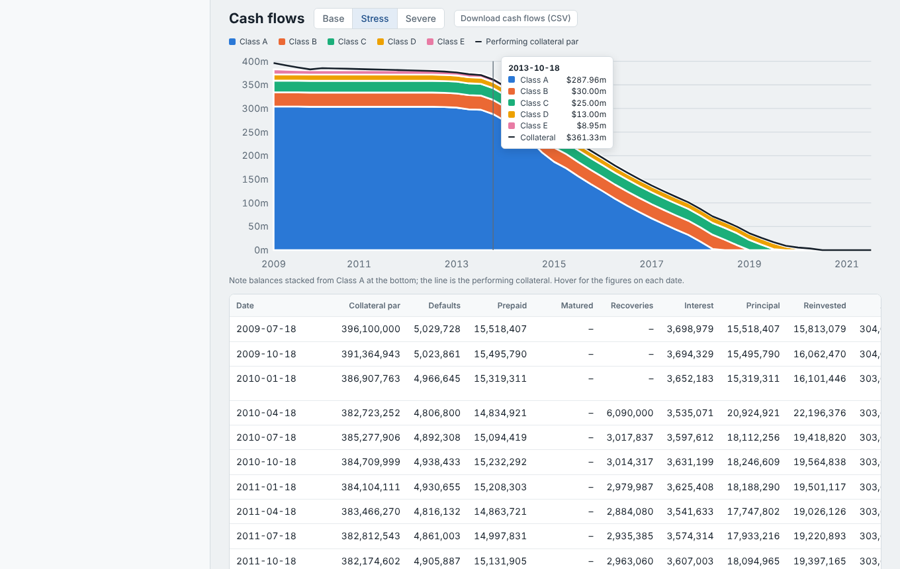

# CLO Indenture Interpreter

**[Open the live tool](https://anandbhamri-dot.github.io/structured-finance-ai-lab/clo-indenture-interpreter/)**

Reads a CLO indenture or offering memorandum in the browser, turns it into a rules model, and runs the Payment Date waterfall and every collateral test with the working behind each figure. It ties the results out to a trustee report and projects the deal to maturity under credit scenarios. A single HTML file; nothing is uploaded anywhere.

It ships with **Example CLO I**, a fictional 2007-vintage deal, and a **fictional sample indenture** for it, so everything can be tried without a real document.

## What it does

**Runs a Payment Date.** The interest, principal and post-acceleration waterfalls run clause by clause, in the indenture's own order. Every Due, Paid and Cash-left figure opens its working: the inputs, the formula and the arithmetic to the cent, with the clause it comes from.

The engine covers:

- **Coverage tests**: OC and IC, measured before payments and pro forma after cures. Each cure solves for the smallest sequential paydown that passes both tests.
- **Haircuts**: Principal Collateral Value with the defaulted, discount-obligation and CCC-excess haircuts.
- **Diversion**: the interest reinvestment (diversion) test and the Event of Default par test.
- **Fees**: the admin expense cap across prior Payment Dates, senior and subordinated management fees with deferral, and the incentive fee behind its IRR hurdle.
- **Quality and concentration**: collateral quality tests (WARF matrix, spreads, coupon, WAL, diversity, recovery rates) and concentration limits.
- **Inputs**: manual amounts (trustee fees, legal costs, hedge payments) can be tagged to any waterfall step.

**Shows every test's numerator and denominator.** Each one links to the calculation and to the loans behind it. For example, a second lien limit lists the second lien loans with their par, price and rating.

**Reads a new deal without a model.** Drop in a PDF, or an indenture saved from SEC EDGAR. Text rules read the deal terms, each with the page it came from:

- the notes table, the key dates and the fees;
- the OC and IC triggers, the diversion test and the Event of Default test;
- every clause of the Priority of Payments, matched to an engine step;
- quality test limits and concentration limits.

Anything not found, or filled with a standard value, is listed for review. It runs in milliseconds.

**Learns from you.** Where the reader misses something, **Teach the reader** lets you point it to the right place. You can give the term the deal uses, the words printed before the value, how to treat a clause, or which tape test a concentration limit is. Each lesson is tried first on every document read after it, and "Try on this document" previews what it would change. Lessons can be exported and imported to share them. A value entered for one document stays with that document.

**Ties out to a trustee report.** The Tie-out tab lists about 60 figures a trustee report prints for a Payment Date: collections, Principal Collateral Value, every coverage ratio, quality metrics, each waterfall step, and each class's interest, principal and balance. Enter or import the report's figures and each difference is shown against a tolerance. The page includes sample trustee figures for April 2009, with three deliberate differences.

**Projects the deal to maturity.** The Projection tab runs the same engine on every future Payment Date, so cures, diversions, fee deferrals and the incentive fee behave as the indenture says.

- **Collateral**: each loan on the tape defaults and prepays at annual rates (CDR, CPR). Defaulted par is recovered after a lag, and loans repay at maturity.
- **Reinvestment**: principal reinvested during the Reinvestment Period buys new loans at a chosen spread, price and term.
- **Scenarios**: Base, Stress and Severe run side by side, with class WAL, losses, equity distributions and equity IRR, plus a cash flow table and chart for each.
- **Calls**: an optional call or the final maturity sells the remaining collateral.

## Try it

1. Open the live tool. Example CLO I is loaded on its April 2009 Payment Date, a credit-stress scenario.
2. Select any figure in the waterfall to see its working.
3. **Indenture rules → Try the sample indenture** reads the fictional indenture in `sample_inputs/`.
4. **Tie-out → Try the sample trustee figures**, then **Projection → Run the projection**.
5. Any CLO indenture filed on SEC EDGAR (often an exhibit to a BDC's 8-K or 10-Q) can be dropped in the same way. Offering memoranda in PDF work too.

Sample files in `sample_inputs/`:

| File | What it is |
|---|---|
| `example-clo-indenture.txt` | Fictional indenture for Example CLO I, written for this project |
| `example-tape-apr09.csv` | The loan tape for the April 2009 scenario (fictional obligors) |
| `example-tieout-apr09.csv` | Sample trustee figures for the tie-out, with three deliberate differences |
| `example-lessons.json` | Example lessons to import into Teach the reader |

## Tested on real documents

The reader was checked on six real deal documents, none of them in this repository. The four indentures are public SEC filings (linked); the two offering memoranda are not public:

| Document | Rated classes | Interest / principal / post-acceleration clauses | Not modelled | Coverage tests | Concentration limits | Items to review | Spec valid |
|---|---|---|---|---|---|---|---|
| A 2007 US CLO offering memorandum (private placement, PDF) | 5 | 19 / 10 / 13 | 0 | 4 + IRT + EoD | 17 | 6 | yes |
| A 2013 US CLO offering memorandum (PDF) | 6 | 25 / 11 / 19 | 0 | 5 + IRT + EoD | 14 | 8 | yes |
| [TICC CLO LLC, 2011 indenture](https://www.sec.gov/Archives/edgar/data/0001259429/000119312511219331/dex103.htm) | 1 | 8 / 10 / 7 | 2 | 1 + IRT | 17 | 17 | yes |
| [Barings BDC Static CLO 2019-I, 2019 indenture](https://www.sec.gov/Archives/edgar/data/1379785/000137978519000025/exhbiti101-cloindenture.htm) | 2 | 9 / 7 / 10 | 0 | 1 + EoD | none in deal | 6 | yes |
| [PennantPark CLO I, 2019 indenture](https://www.sec.gov/Archives/edgar/data/1504619/000119312519250688/d808045dex992.htm) | 8 | 14 / 15 / 18 | 0 | 3 | 13 | 9 | yes |
| [Barings Private Credit CLO 2026-1, 2026 indenture (SOFR)](https://www.sec.gov/Archives/edgar/data/1859919/000185991926000047/exhibit102-indenture.htm) | 3 | 13 / 11 / 13 | 0 | 2 + EoD | none in deal | 5 | yes |

For the 2007 memorandum, a field-by-field check against a hand-built spec matched 84 of 84 fields, and 150 of 150 waterfall payments and OC ratios. Most items left to review are fees set in the collateral management agreement rather than the indenture, matrix-based quality tests and equity amounts the indenture does not state. Those items are what **Teach the reader** is for.

## Validation

`npm test` runs, with no network or documents needed:

- **Engine audit**: re-evaluates all 6,891 expressions shown in the working panels and checks 4,682 totals tie to the ledger.
- **Golden-file regression**: compares the engine's results on the built-in scenarios with a stored file.
- **Reader test**: the reader on the sample indenture must reproduce the built-in deal spec (72 checks).
- **Lessons test**: lessons carry from one document to the next and change nothing they were not aimed at.
- **Projection test**: par and note balances roll forward every period, losses rise from Base to Severe, and a par call repays every class.
- **Fuzz tests**: random and hostile lessons, and deleting any part of a deal spec, never break the reader or the engine.

`npm run test:ui` runs browser checks with Playwright, including phone width and downloads outside Claude. Set `CLO_DOCS` to a folder of real indentures to include them. GitHub Actions runs everything on each push.

**Not yet tied out to a real trustee report.** Trustee reports are not public. The Tie-out tab is how to do it, and it is the next step before relying on the model for a live deal.

## How it is built

`src/` holds the engine (`engine.js`), the built-in deal and scenarios (`data.js`), the text reader (`rulereader.js`, `docclauses.js`, `docpages.js`), the projection (`projection.js`) and the page (`shell.html`, `app.js` and the panel modules). `node build.js` assembles them into the single `index.html`, with no dependencies. The page also runs inside Claude as an artifact, where an optional "Ask Claude" step can fill gaps the rules could not read. Outside Claude that step is hidden and everything else works the same.

## Scope and limitations

A modelling and review tool, not a replacement for Intex or a trustee's system.

- **Matrix limits**: quality tests that use a matrix (WARF and spread matrices, the S&P CDO Monitor) are entered by hand.
- **Standard values**: recovery tables and haircut terms the document does not state use standard values, and the reader lists them for review.
- **Interest Proceeds**: estimated from the loan tape unless entered.
- **Projection simplifications**:
  - Collateral is modelled at the loan level with flat annual default and prepayment rates and a flat index.
  - Reinvestment buys one generic loan per period.
  - Quality tests are reported but do not restrict reinvestment.
  - Administrative expenses are a fixed amount per date.
- **Not modelled**: Class X notes, combination notes, refinancing and reset, and hedges beyond the amounts entered.
- **Coverage so far**: tested on US cash-flow CLOs only. European deals follow the same structure but have not been tested.

## Data and licence

All built-in data is fictional: Example CLO I, its sample indenture, the loan tapes and the trustee figures. Real deal documents read with the tool stay in the browser and are not part of this repository. MIT licence; see `LICENSE`. Not investment advice.

---
Built by Anand Bhamri, with Claude as a modelling and coding partner. Single HTML file, no install.
