# CLO Indenture Interpreter

**[Open the live tool](https://anandbhamri-dot.github.io/structured-finance-ai-lab/clo-indenture-interpreter/)**

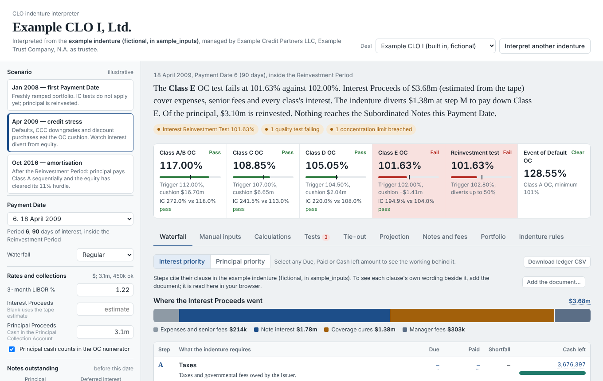

Reads a CLO indenture or offering memorandum in the browser, turns it into a rules model, and runs the Payment Date waterfall and every collateral test with the working behind each figure. It ties the results out to a trustee report and projects the deal to maturity under credit scenarios. A single HTML file; nothing is uploaded anywhere.

It ships with **Example CLO I**, a fictional 2007-vintage deal, and a **fictional sample indenture** for it, so everything can be tried without a real document.

## What it does

**Runs a Payment Date.** The interest, principal and post-acceleration waterfalls run clause by clause, in the indenture's own order. Every Due, Paid and Cash-left figure opens its working: the inputs, the formula and the arithmetic to the cent, with the clause it comes from.

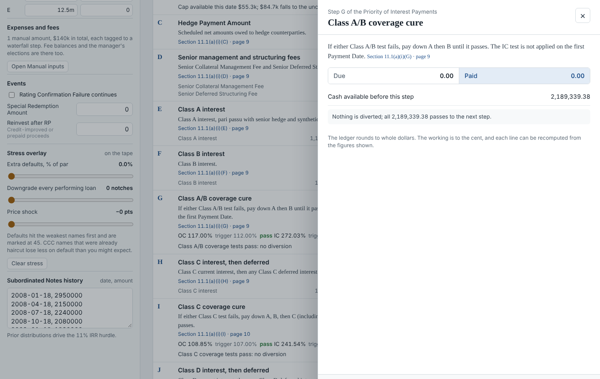

The engine covers:

- **Coverage tests**: OC and IC, measured before payments and pro forma after cures. Each cure solves for the smallest sequential paydown that passes both tests.
- **Haircuts**: Principal Collateral Value with the defaulted, discount-obligation and CCC-excess haircuts.
- **Diversion**: the interest reinvestment (diversion) test and the Event of Default par test.
- **Fees**: the admin expense cap across prior Payment Dates, senior and subordinated management fees with deferral, and the incentive fee behind its IRR hurdle.
- **Quality and concentration**: collateral quality tests (WARF matrix, spreads, coupon, WAL, diversity, recovery rates) and concentration limits.
- **Inputs**: manual amounts (trustee fees, legal costs, hedge payments) can be tagged to any waterfall step. An amount can be a formula.

**Shows every test's numerator and denominator.** Each one links to the calculation and to the loans behind it. For example, a second lien limit lists the second lien loans with their par, price and rating.

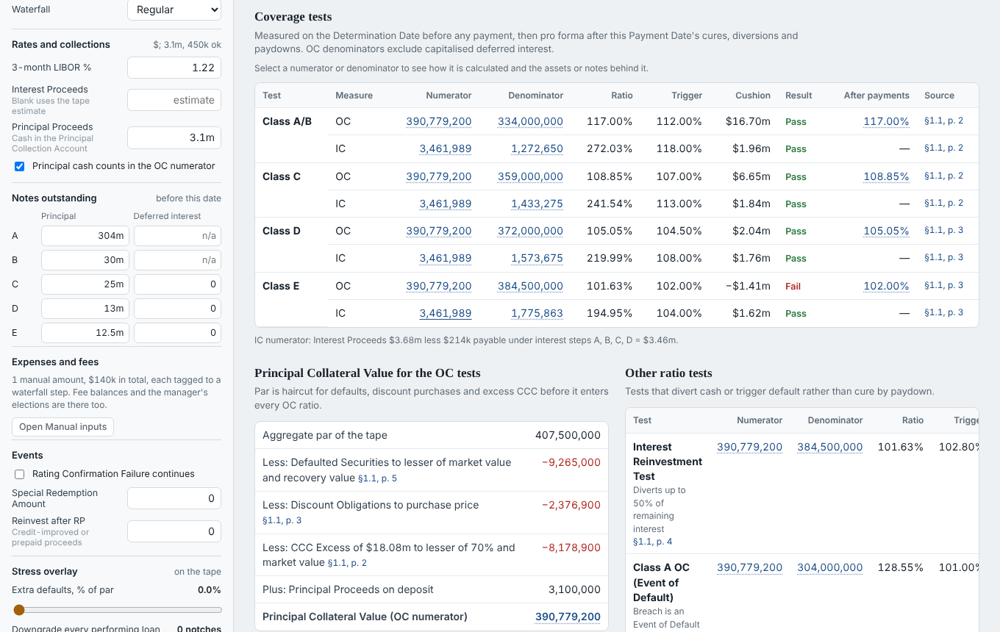

**Adjusts any test to the deal's own definition.** Every coverage, quality and Portfolio Profile test has an **Adjust** link. It opens a panel where you can:

- **Leave loans out of the numerator or the denominator.** Defaulted, CCC, discount, cov-lite and PIK loans take one click. Any other field takes a condition, such as `country <> "US"`, `price < 80`, a column from your tape or one of your loan calculations.
- **Set the numerator to a field and a value.** Pick a field, then one of its values from a list with a count of loans for each. For example, `industry` is Healthcare, or `asset_type` is 2L. The test then counts only those loans, in place of the clause's own test. Several conditions must all hold.
- **Add tests of your own.** A test can be the share of loans that meet conditions you set, or the largest single value of any field, such as the largest country. Each has a limit you enter, as a maximum or a minimum.

The panel shows the test as the indenture reads it and as you adjusted it, and each condition says how many loans it catches. Changes apply at once. The working behind the numerator and the denominator lists the loans left out.

Loans left out of a coverage test's numerator come off at their carrying value, for that test only. The waterfall's cures and diversions, and the projection, then follow your version of the test. Adjustments and your own tests are saved per deal, and travel with the Calculations JSON export.

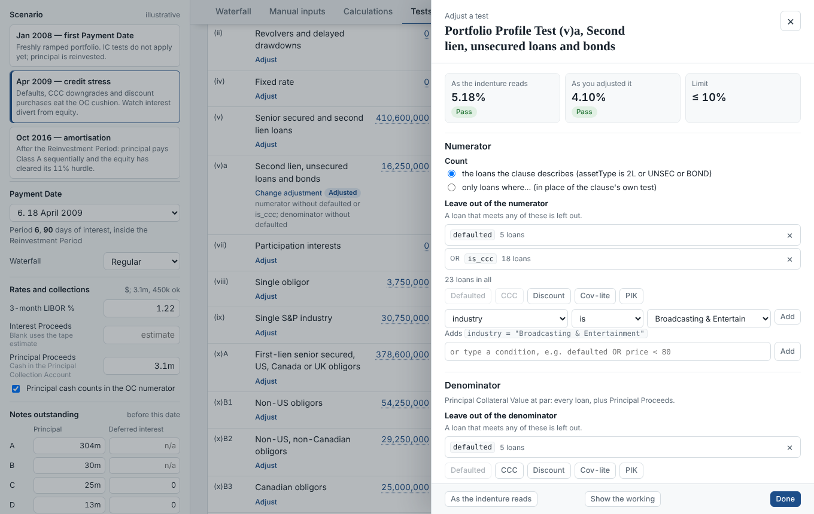

**Reads a new deal without a model.** Drop in a PDF, or an indenture saved from SEC EDGAR. Text rules read the deal terms, each with the page it came from:

- the notes table, the key dates and the fees;
- the OC and IC triggers, the diversion test and the Event of Default test;
- every clause of the Priority of Payments, matched to an engine step;
- quality test limits and concentration limits.

Anything not found, or filled with a standard value, is listed for review. It runs in milliseconds.

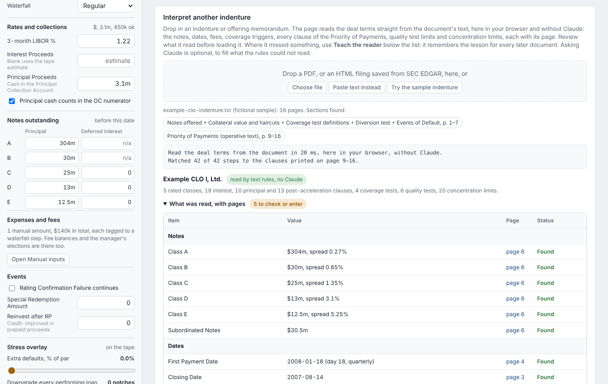

**Corrects what the interpreter gets wrong.** Where a figure is not worked out the way the indenture says, the **Calculations** tab lets you write your own as a formula. A calculation can replace one of these figures, and everything that uses it then uses yours:

- the Fee Basis Amount;
- Principal Collateral Value;
- a management fee due;
- the Interest Proceeds, Principal Proceeds or Administrative Expenses;
- a loan's par, price, spread, default flag, Moody's rating or S&P rating.

There are two kinds of calculation:

- A **deal figure** is one number per Payment Date. For example, a `Fee_Basis_Amount_2` that counts Defaulted Obligations at their carrying value: `SUM(par, NOT defaulted) + SUM(oc_balance, defaulted) + Principal_Proceeds`.
- A **loan column** is worked out for every loan. For example, `IFBLANK(principal_balance, par)` puts the tape's Principal Balance column in place of par. Any column on an uploaded tape can be used by name.

Formulas can use the interpreter's own figures for the Payment Date, and each other. The built-in figures include:

- **Collateral and cash**: `Aggregate_Principal_Balance`, `Principal_Collateral_Value`, the haircuts, `Interest_Proceeds`, `Principal_Proceeds`.
- **Notes and tests**: each class's balance, rate and interest due, and each test's ratio and trigger.
- **Fees**: the fee basis, each fee due, and each fee's rate on the Payment Date, so `Fee_Basis_Amount_2 * Senior_Management_Fee_Rate% * Day_Count_Fraction` works the senior fee out again.
- **Dates and deal terms**: `Payment_Date`, `First_Payment_Date`, `Closing_Date`, `Reinvestment_Period_End_Date`, `Non_Call_Period_End_Date`, `Stated_Maturity_Date`, `Target_Par_Amount`.

Formulas support arithmetic, percentages, comparisons, `IF`, `MIN`, `MAX` and `ROUND`, and sums and averages over loans with a condition. Date functions such as `DAYS`, `YEARS` and `EDATE` work on the deal's dates and on the tape's maturity and default dates. Typing part of a name lists every name that matches, with its current value, and Enter puts the chosen one in. Each value opens its working, and the working lists the loans behind every sum. A Manual inputs amount that starts with `=` is a formula too, such as `=ROUND(Fee_Basis_Amount_2 * 0.02% * Day_Count_Fraction, 2)`.

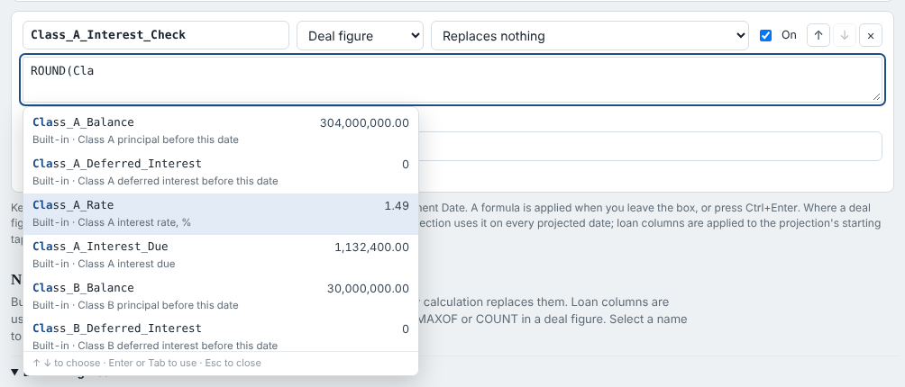

**Groups** hold the steps of a longer calculation under one name, such as Principal Balance or Moody's rating. Each step can use the ones before it, and the last can replace the tape's figure. A group can be renamed, reordered, switched on and off, or hidden as a whole. Its working shows every step side by side for each loan, with the loans the final step changes listed first. Rating functions (`SP_TO_MOODYS`, `MOODYS_TO_SP`, `NOTCH`, `RATING_RANK`, `RATING_FACTOR`) cover rating calculations, for example a Moody's rating one notch below the S&P equivalent where a loan has none.

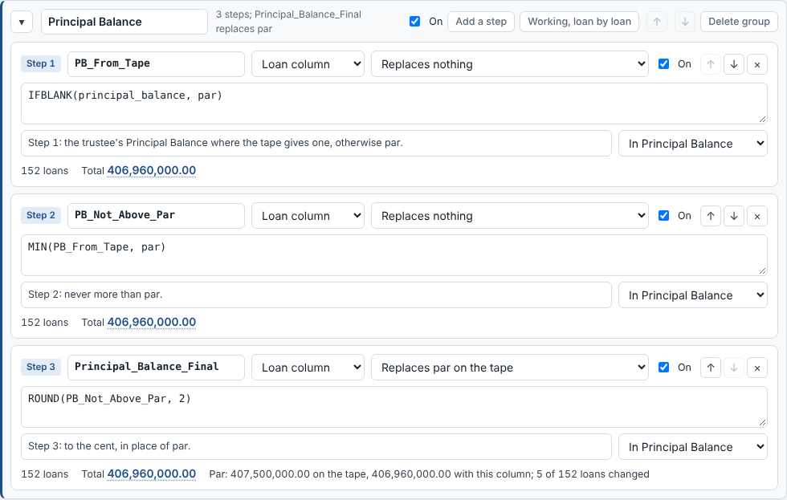

Calculations are saved per deal and can be exported and imported as JSON. The projection applies replacements of the fee basis, collateral value and fees on every projected date, and loan columns to its starting tape.

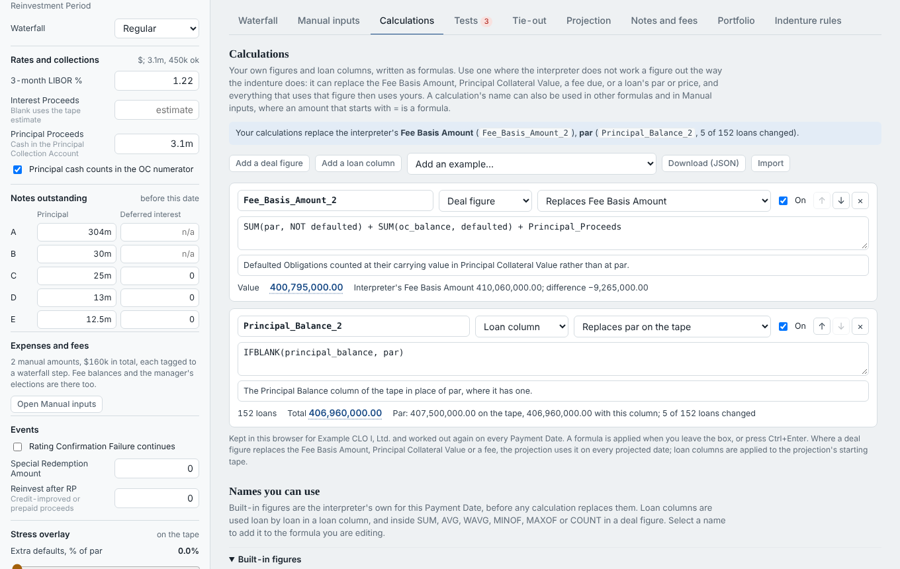

**Reads a deal from several documents.** Where a deal's terms are spread over more than one document, add them all to one reading. That might be the indenture, the collateral management agreement that sets the fees, and any supplemental indentures. The documents are read in the order listed, so where two give the same term the first is normally used; an amendment goes above the document it amends. Every page reference names its document, and values you entered for one document still apply when another is added. The page includes a fictional supplemental indenture that amends two quality tests in the sample indenture.

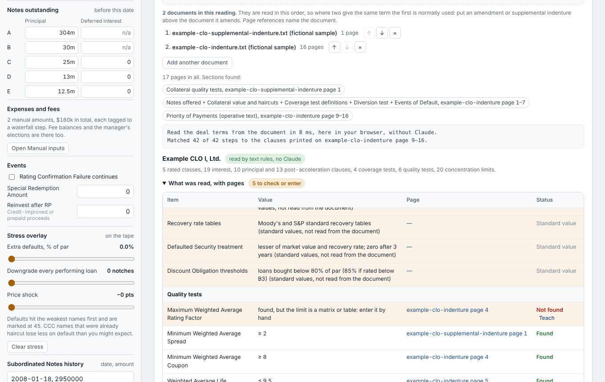

**Learns from you.** Where the reader misses something, **Teach the reader** lets you point it to the right place. You can give the term the deal uses, the words printed before the value, how to treat a clause, or which tape test a concentration limit is. Each lesson is tried first on every document read after it, and "Try on this document" previews what it would change. Lessons can be exported and imported to share them. A value entered for one document stays with that document.

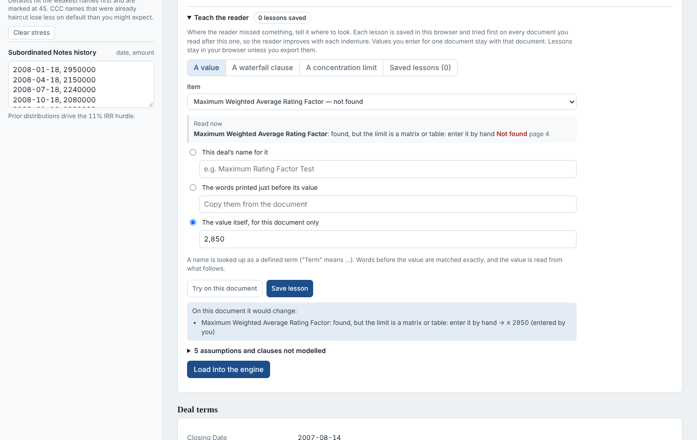

**Ties out to a trustee report.** The Tie-out tab lists about 60 figures a trustee report prints for a Payment Date: collections, Principal Collateral Value, every coverage ratio, quality metrics, each waterfall step, and each class's interest, principal and balance. Enter or import the report's figures and each difference is shown against a tolerance. The page includes sample trustee figures for April 2009, with three deliberate differences.

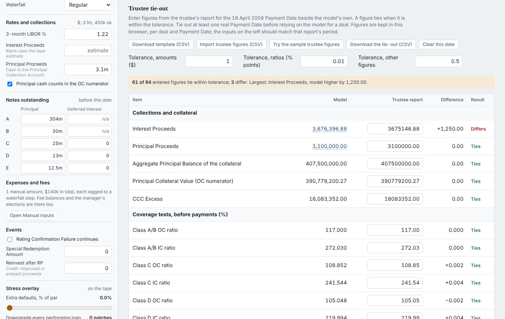

**Projects the deal to maturity.** The Projection tab runs the same engine on every future Payment Date, so cures, diversions, fee deferrals and the incentive fee behave as the indenture says.

- **Collateral**: each loan on the tape defaults and prepays at annual rates (CDR, CPR). Defaulted par is recovered after a lag, and loans repay at maturity.
- **Reinvestment**: principal reinvested during the Reinvestment Period buys new loans at a chosen spread, price and term.
- **Scenarios**: Base, Stress and Severe run side by side, with class WAL, losses, equity distributions and equity IRR, plus a cash flow table and chart for each.
- **Calls**: an optional call or the final maturity sells the remaining collateral.

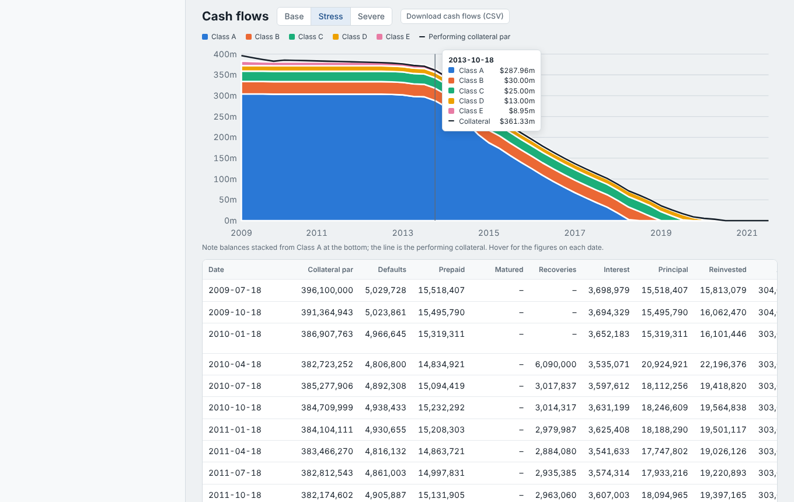

## Try it

1. Open the live tool. Example CLO I is loaded on its April 2009 Payment Date, a credit-stress scenario.
2. Select any figure in the waterfall to see its working.
3. **Tests → Adjust**, next to any test, leaves loans out of its numerator or denominator, or sets its numerator to a field and a value. **Add a test of your own** is under the Portfolio Profile Test.
4. **Calculations → Add an example** adds a Fee Basis Amount worked out a different way, or the tape's Principal Balance in place of par. In a formula box, type part of a name, such as `Cla`, to pick from the names that match.
5. **Indenture rules → Try the sample indenture** reads the fictional indenture in `sample_inputs/`. **Add the sample supplemental indenture** then reads it together with an amendment.
6. **Tie-out → Try the sample trustee figures**, then **Projection → Run the projection**.
7. Any CLO indenture filed on SEC EDGAR (often an exhibit to a BDC's 8-K or 10-Q) can be dropped in the same way. Offering memoranda in PDF work too.

Sample files in `sample_inputs/`:

| File | What it is |
|---|---|
| `example-clo-indenture.txt` | Fictional indenture for Example CLO I, written for this project |
| `example-clo-supplemental-indenture.txt` | Fictional supplemental indenture that amends two of its quality tests |
| `example-tape-apr09.csv` | The loan tape for the April 2009 scenario (fictional obligors), with a Principal Balance column for the Calculations tab |
| `example-tieout-apr09.csv` | Sample trustee figures for the tie-out, with three deliberate differences |
| `example-lessons.json` | Example lessons to import into Teach the reader |

## Tested on real documents

The reader was checked on six real deal documents, none of them in this repository. The four indentures are public SEC filings (linked); the two offering memoranda are not public:

| Document | Rated classes | Interest / principal / post-acceleration clauses | Not modelled | Coverage tests | Concentration limits | Items to review | Spec valid |
|---|---|---|---|---|---|---|---|
| A 2007 US CLO offering memorandum (private placement, PDF) | 5 | 19 / 10 / 13 | 0 | 4 + IRT + EoD | 17 | 1 | yes |
| A 2013 US CLO offering memorandum (PDF) | 6 | 25 / 11 / 19 | 0 | 5 + IRT + EoD | 15 | 6 | yes |
| [TICC CLO LLC, 2011 indenture](https://www.sec.gov/Archives/edgar/data/0001259429/000119312511219331/dex103.htm) | 1 | 8 / 10 / 7 | 0 | 1 + IRT + EoD | 17 | 7 | yes |
| [Barings BDC Static CLO 2019-I, 2019 indenture](https://www.sec.gov/Archives/edgar/data/1379785/000137978519000025/exhbiti101-cloindenture.htm) | 2 | 9 / 7 / 10 | 0 | 1 + EoD | none in deal | 6 | yes |
| [PennantPark CLO I, 2019 indenture](https://www.sec.gov/Archives/edgar/data/1504619/000119312519250688/d808045dex992.htm) | 8 | 14 / 15 / 18 | 0 | 3 + EoD | 14 | 3 | yes |
| [Barings Private Credit CLO 2026-1, 2026 indenture (SOFR)](https://www.sec.gov/Archives/edgar/data/1859919/000185991926000047/exhibit102-indenture.htm) | 3 | 13 / 11 / 13 | 0 | 2 + EoD | none in deal | 4 | yes |

The TICC and PennantPark indentures were also read as PDFs printed from EDGAR, with the same results as their HTML filings. For the 2007 memorandum, a field-by-field check against a hand-built spec matched 84 of 84 fields, and 150 of 150 waterfall payments and OC ratios.

The items left to review are mostly of three kinds:

- **Fees set in the collateral management agreement**, not the indenture. Add the agreement to the reading as a second document. Where the indenture sets a fee at zero while a named manager serves, as TICC's does, the reader takes 0%.
- **Quality test limits the manager chooses.** Where the document prints the quality matrix, the reader takes the WARF limit from it at the portfolio's own spread and diversity, and the lowest row and column as the spread and diversity minimums, flagged for review. Limits set by a rating agency model, or by an option the manager elects, are entered with **Teach the reader**.
- **Concentration limits with no matching tape field**, such as limits on convertible features, derived ratings or tax jurisdictions.

## Validation

`npm test` runs, with no network or documents needed:

- **Engine audit**: re-evaluates all 10,666 expressions shown in the working panels and checks 7,380 totals tie to the ledger. This includes runs where calculations replace the fee basis, collateral value, fees and par, and runs with adjusted tests and tests of your own.
- **Calculations test**: the formula language, dates, ratings, groups, its error messages, and that each replacement reaches the engine (93 checks).
- **Adjusted tests**: each adjusted figure is worked out again from the loans, independently of the engine's code (45 checks). The checks cover:
  - loans left out of numerators and denominators;
  - a field and a value as the numerator;
  - tests of your own;
  - a coverage test whose cure follows your version;
  - conditions with errors;
  - random sets of adjustments.
- **Golden-file regression**: compares the engine's results on the built-in scenarios with a stored file.
- **Reader test**: the reader on the sample indenture must reproduce the built-in deal spec (72 checks).
- **Reader on other forms**: the sample indenture rewritten as PDF text comes out (lines broken mid-phrase, the notes table a row per line), and in wordings taken from real indentures, still reads correctly (31 checks).
- **Lessons test**: lessons carry from one document to the next and change nothing they were not aimed at.
- **Several documents**: an amendment listed first takes priority, fees moved to a separate agreement are found there, and pages name their document (20 checks).
- **Projection test**: par and note balances roll forward every period, losses rise from Base to Severe, and a par call repays every class.
- **Fuzz tests**: random and hostile lessons, random formulas, random test adjustments, and deleting any part of a deal spec, never break the reader or the engine.

`npm run test:ui` runs browser checks with Playwright, including phone width and downloads outside Claude. Set `CLO_DOCS` to a folder of real indentures to include them. GitHub Actions runs everything on each push.

**Not yet tied out to a real trustee report.** Trustee reports are not public. The Tie-out tab is how to do it, and it is the next step before relying on the model for a live deal.

## How it is built

`src/` holds the engine (`engine.js`), the built-in deal and scenarios (`data.js`), the text reader (`rulereader.js`, `docclauses.js`, `docpages.js`), the formula language (`calc.js`), the projection (`projection.js`) and the page (`shell.html`, `app.js` and the panel modules). `node build.js` assembles them into the single `index.html`, with no dependencies. The page also runs inside Claude as an artifact, where an optional "Ask Claude" step can fill gaps the rules could not read. Outside Claude that step is hidden and everything else works the same.

## Scope and limitations

A modelling and review tool, not a replacement for Intex or a trustee's system.

- **Matrix limits**: a printed spread-by-diversity WARF matrix is read; its recovery adjustment, other matrix layouts and the S&P CDO Monitor are entered by hand.
- **Standard values**: recovery tables and haircut terms the document does not state use standard values, and the reader lists them for review.
- **Interest Proceeds**: estimated from the loan tape unless entered.
- **Projection simplifications**:
  - Collateral is modelled at the loan level with flat annual default and prepayment rates and a flat index.
  - Reinvestment buys one generic loan per period.
  - Quality tests are reported but do not restrict reinvestment.
  - Administrative expenses are a fixed amount per date.
- **Calculations**: built-in figures in a formula are the interpreter's own for the Payment Date, worked out before any deal-level replacement. A replaced Fee Basis Amount does not change `Fee_Basis_Amount`; name your own calculation to use the replacement. Loan columns are worked out on the tape as uploaded.
- **Adjusted tests**:
  - A measure you adjust is used wherever the indenture uses it. For example, an adjusted Moody's recovery rate feeds the spread test's recovery modifier.
  - A coverage test's denominator is the notes, so only its numerator takes loan conditions.
  - The projection applies adjusted coverage tests on every date. Other adjusted tests do not change the cash, so it does not apply them.
  - A condition that uses a loan calculation sees it as worked out on the uploaded tape. A tape column in a condition shows any replacement.
- **Several documents**: the reader takes the first instance of most terms in the order the documents are listed. It does not interpret amending language such as "Section 1.1 is amended by deleting…"; it reads the restated definitions.
- **Not modelled**: Class X notes, combination notes, refinancing and reset, and hedges beyond the amounts entered.
- **Coverage so far**: tested on US cash-flow CLOs only. European deals follow the same structure but have not been tested.

## Data and licence

All built-in data is fictional: Example CLO I, its sample indenture, the loan tapes and the trustee figures. Real deal documents read with the tool stay in the browser and are not part of this repository. MIT licence; see `LICENSE`. Not investment advice.

---
Built by Anand Bhamri, with Claude as a modelling and coding partner. Single HTML file, no install.
